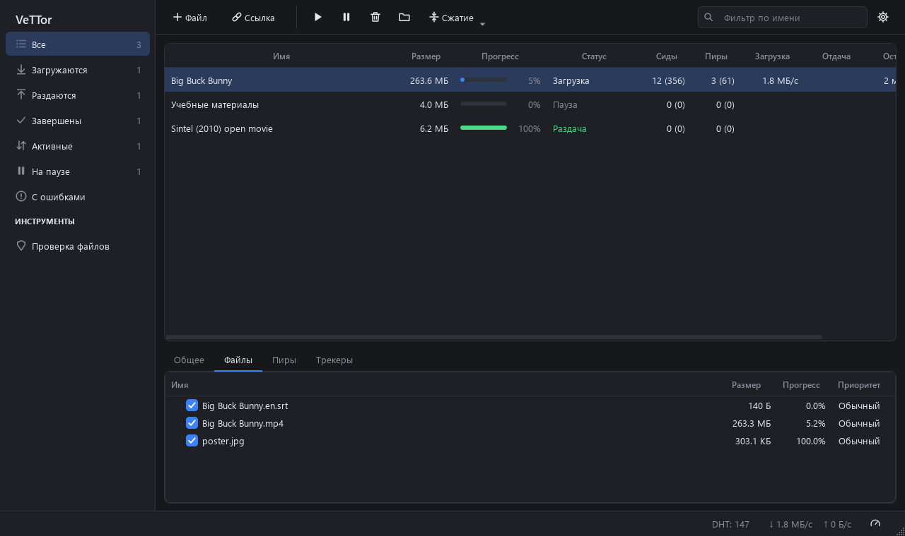
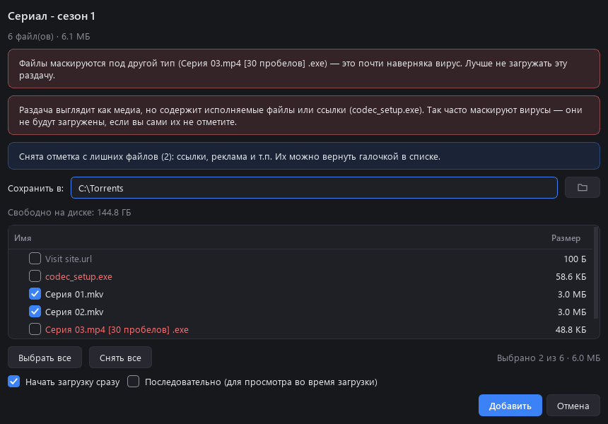
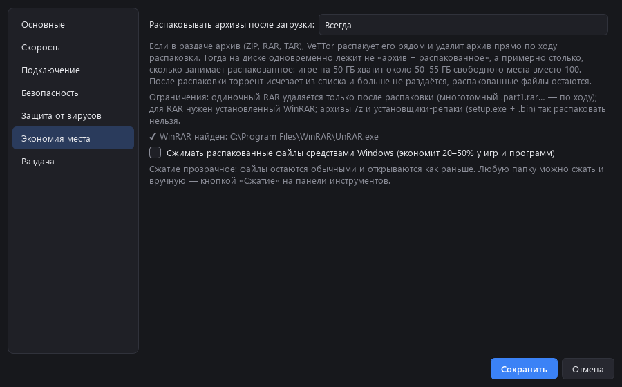
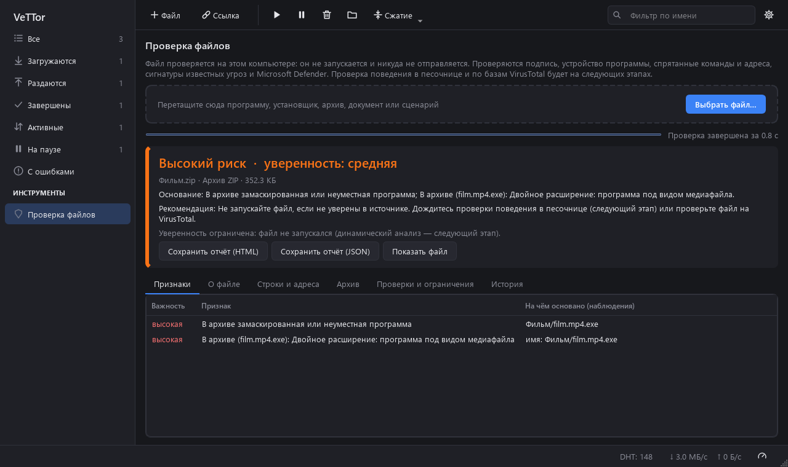

<div align="center">

# VeTTor

**Торрент-клиент для Windows, который заботится о вашем компьютере, а не о показах рекламы.**

Без рекламы · без программ «в нагрузку» · с защитой от вирусов в раздачах · с экономией места на диске




</div>

---

## Зачем ещё один торрент-клиент?

Многие привычные торрент-клиенты со временем обрастают тем, что пользователю не нужно: рекламой в окне,
«партнёрскими» программами в установщике, лишними файлами и ссылками на сайты в каждой загрузке.
А главная опасность торрентов — вирусы, замаскированные под фильмы и игры, — обычно остаётся
вашей проблемой.

**VeTTor делает обратное:** он ничего не показывает и не навязывает, а время, которое другие тратят
на рекламу, тратит на то, чтобы скачанное было безопасным и не съело весь диск.

| | Обычный клиент | **VeTTor** |
|---|:---:|:---:|
| Реклама в окне и в установщике | часто | **никогда** |
| Замечает `Серия 03.mp4.exe` и `codec_setup.exe` в раздаче сериала | нет | **да, и не скачивает их** |
| Проверяет каждый докачанный файл и удаляет заражённые | нет | **да** |
| Распаковка архива без «архив + распакованное» на диске | нет | **да** |
| Подробная проверка любого файла с отчётом | нет | **да** |
| Телеметрия и сбор данных | бывает | **нет** |

---

## Что умеет VeTTor

### 🛡️ Защищает от вирусов в раздачах

Самый частый способ подсунуть вирус через торрент — выдать программу за видео или «кодек».
VeTTor распознаёт это **ещё до начала загрузки**:

- двойные расширения: `фильм.mp4.exe`;
- расширение, спрятанное за десятками пробелов: `Серия 03.mp4                    .exe`;
- невидимые символы Unicode, переставляющие буквы в имени (`film[U+202E]4pm.exe` на экране выглядит как `filmexe.mp4`);
- программы, ярлыки и «кодеки» в раздачах фильмов и музыки;
- символические ссылки, указывающие за пределы папки загрузки.

Такие файлы не скачиваются, а вы получаете понятное объяснение — почему.

<div align="center"></div>

### 🔬 Проверяет каждый файл сразу после загрузки

Как только файл докачан, VeTTor проверяет его встроенным **Microsoft Defender**, а видео и картинки —
ещё и на спрятанную внутри программу. Заражённый файл удаляется и больше не скачивается, а остальные
файлы раздачи остаются нетронутыми и продолжают раздаваться — без ошибок и долгих перепроверок.

Дополнительно скачанное помечается как «загруженное из интернета» (как это делают браузеры):
Windows SmartScreen проверит программу перед запуском, а Word и Excel откроют документы
в защищённом режиме.

### 💾 Экономит место на диске

Игра на 50 ГБ в архиве — и вдруг оказывается, что для распаковки нужно ещё 50 ГБ.
VeTTor распаковывает ZIP, RAR и TAR **и удаляет архив прямо по ходу распаковки**:
на диске одновременно лежит не «архив + распакованное», а примерно столько, сколько занимает результат.

| | Обычная распаковка | **VeTTor** |
|---|:---:|:---:|
| Игра в архиве 50 ГБ → нужно свободного места | ~100 ГБ | **~55 ГБ** |

Ещё VeTTor заранее проверяет, хватит ли места на загрузку, и умеет **прозрачно сжимать папки**
средствами Windows — игры и программы обычно занимают на 20–50% меньше и работают как раньше.

<div align="center"></div>

### 🔍 Проверяет любой файл — подробно и честно

Раздел **«Проверка файлов»** разбирает программу, установщик, архив, документ или сценарий
**без запуска и без отправки куда-либо**:

- хэши SHA-256 / SHA-1 / MD5 и настоящий тип файла по содержимому;
- цифровая подпись и признаки самозванства («называет себя Microsoft, но не подписана Microsoft»);
- устройство программы: функции для внедрения в чужие процессы и перехвата клавиатуры, упаковщики;
- спрятанные адреса и опасные команды: удаление резервных копий, отключение защиты, кража паролей;
- макросы в документах Office, JavaScript в PDF, ярлыки, запускающие команды;
- архивы — вместе с файлами внутри, с защитой от «архивов-бомб»;
- сигнатуры YARA и Microsoft Defender.

Итог — одна из пяти оценок (*Вредоносный · Высокий риск · Требует проверки · Низкий риск ·
Недостаточно данных*) с уровнем уверенности и **фактами, на которых она основана**.
VeTTor не пугает зря: отсутствие подписи или упаковщик сами по себе не считаются заражением.
И не обещает невозможного: отчёт прямо говорит, что проверено, а что — нет.

<div align="center"></div>

### ⚙️ И всё, что нужно от хорошего торрент-клиента

- .torrent и magnet-ссылки, перетаскивание в окно, вставка по Ctrl+V — загрузка начинается сразу;
- очередь, приоритеты файлов, последовательная загрузка (смотреть видео во время скачивания);
- общие и альтернативные лимиты скорости, расписание;
- шифрование, анонимный режим, прокси SOCKS5/HTTP, IP-фильтр;
- **привязка к VPN**: если VPN отключится, загрузки остановятся сами — трафик не уйдёт мимо него;
- лимиты раздачи по рейтингу и времени;
- значок у часов, уведомления, тёмная и светлая тема.

---

## Конфиденциальность

- VeTTor **ничего не отправляет** разработчику: ни статистики, ни отчётов, ни «анонимных данных».
- Проверка файлов идёт **на вашем компьютере**; файлы никуда не загружаются.
- Пароль прокси шифруется средствами Windows (DPAPI) — прочитать его может только ваша учётная запись.

## Безопасность самой программы

- Проверка файлов выполняется в **отдельном процессе** с ограничением памяти и времени:
  специально испорченный файл не «повесит» клиент.
- Распаковка не даёт архиву записать файлы за пределы папки (`..\..\Windows\…`),
  обезвреживает имена вроде `CON` и потоки NTFS.
- Имена и комментарии из торрентов отображаются как обычный текст — подделать ими интерфейс нельзя.
- Ссылки от веб-страниц и других программ принимаются только от вашей учётной записи Windows.

---

## Установка

> Готовой сборки пока нет — VeTTor собирается из исходников за пару минут.

**Нужно:** Windows 10 или 11, [Python 3.10+](https://www.python.org/downloads/).
**По желанию:** [WinRAR](https://www.win-rar.com/) — для распаковки RAR-архивов.

```powershell
git clone https://github.com/Veil-Neron/VeTTor.git
cd VeTTor
python -m venv .venv
.venv\Scripts\pip install -r requirements.txt

# запустить из исходников
.venv\Scripts\pythonw VeTTor.pyw
```

**Собрать VeTTor.exe и установить** (ярлыки на рабочем столе и в «Пуске», удаление через «Приложения»):

```powershell
.venv\Scripts\pip install pyinstaller
.venv\Scripts\pyinstaller --noconfirm --clean --windowed --onedir --name VeTTor --icon build_assets\vettor.ico --collect-binaries libtorrent --hidden-import libtorrent --hidden-import yara --hidden-import pefile --add-data "vettor/analysis/rules.yar;vettor/analysis" --exclude-module tkinter VeTTor.pyw
powershell -ExecutionPolicy Bypass -File packaging\install.ps1
```

Программа ставится в `%LOCALAPPDATA%\Programs\VeTTor`, права администратора не нужны.

> **Почему Windows предупреждает при первом запуске?** У VeTTor нет платной цифровой подписи,
> поэтому SmartScreen покажет «Неизвестный издатель». Нажмите «Подробнее» → «Выполнить в любом случае».
> Исходный код открыт — вы можете проверить его сами.

---

## Честно об ограничениях

- Распаковка с экономией места работает для ZIP, TAR и RAR (многотомный RAR — по томам, одиночный — после
  распаковки). Архивы **7z** и **установщики-репаки** (`setup.exe` + `.bin`) так распаковать нельзя.
- После распаковки с экономией места торрент перестаёт раздаваться — архива больше нет.
- Проверка файлов — статическая: файл не запускается, и его поведение пока не наблюдается.
  Никакая проверка не гарантирует, что файл безопасен.

## Что дальше

- [ ] Проверка файлов по хэшу в базах VirusTotal и MalwareBazaar (файл не отправляется без согласия)
- [ ] Проверка поведения программ в одноразовой песочнице Windows Sandbox с файлами-приманками
- [ ] Готовые сборки в разделе Releases

---

## Для разработчиков

```
vettor/
├── engine.py          сессия libtorrent: очередь, сохранение, лимиты, VPN-привязка
├── safety.py          лишние и опасные файлы в раздаче — до загрузки
├── guard.py           проверка докачанных файлов, удаление заражённых без перепроверки
├── extract.py         распаковка ZIP/TAR/RAR с освобождением прочитанной части архива
├── unpacker.py        когда и какие торренты распаковывать
├── diskspace.py       разреженные файлы, размер на диске, сжатие NTFS
├── antivirus.py       вызов Microsoft Defender
├── analysis/          «Проверка файлов»: статический анализ, оценка риска, отчёты, YARA
└── ui/                окна и виджеты (PySide6)
```

Тесты:

```powershell
.venv\Scripts\python -m unittest discover -s tests -v
```

Свои правила YARA можно положить в `%APPDATA%\VeTTor\yara\*.yar`.

## Ответственное использование

VeTTor — инструмент для обмена файлами по протоколу BitTorrent. Скачивайте только то, на что у вас есть
право: свободно распространяемые программы и дистрибутивы, открытые фильмы и книги, собственные файлы.
Ответственность за загружаемое содержимое несёт пользователь.

## Благодарности

VeTTor построен на открытых проектах:
[libtorrent](https://libtorrent.org) (BSD) ·
[Qt for Python / PySide6](https://doc.qt.io/qtforpython-6/) (LGPL) ·
[pefile](https://github.com/erocarrera/pefile) (MIT) ·
[YARA](https://virustotal.github.io/yara/) (BSD-3) / [yara-python](https://github.com/VirusTotal/yara-python) (Apache 2.0).
Распаковка RAR использует UnRAR из установленного у пользователя WinRAR.

## Лицензия

VeTTor распространяется по лицензии [GNU GPL v3](LICENSE): программу можно свободно использовать,
изучать, изменять и распространять — при условии, что изменённые версии тоже останутся открытыми
под той же лицензией. Так VeTTor не превратится в чей-то закрытый клиент с рекламой.

<div align="center"><sub>Сделано <b>Veil Neron</b></sub></div>
